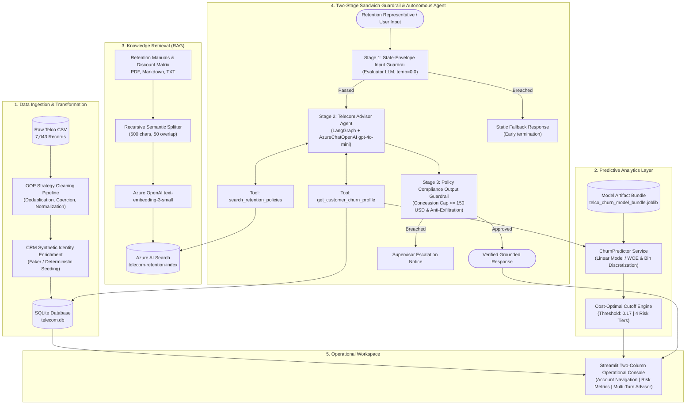
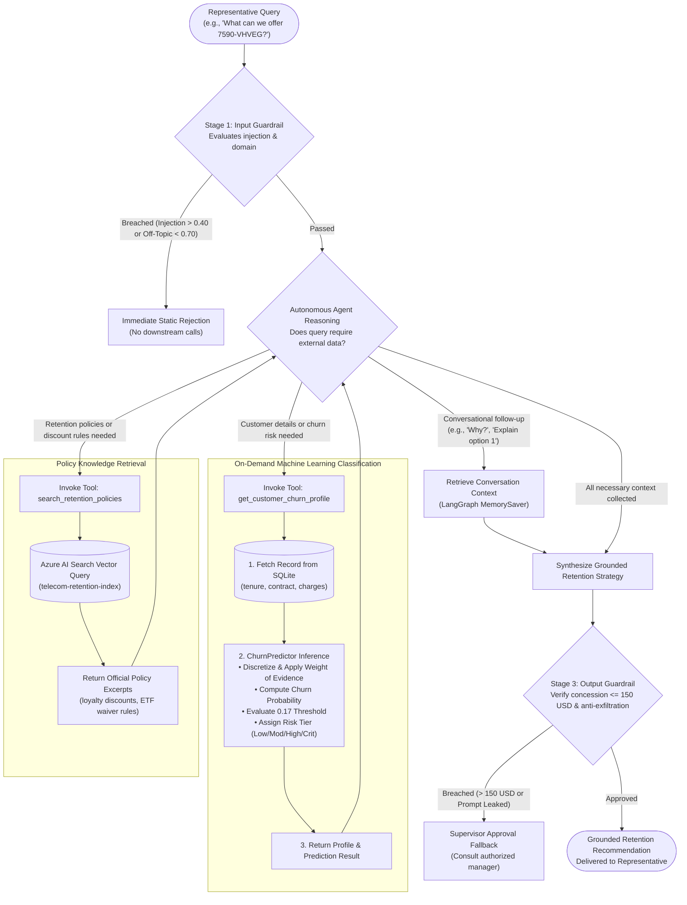

# Telecom Customer Churn Advisor & Retention Console

[](https://www.python.org/)
[](https://www.langchain.com/)
[](https://ai.azure.com/)
[](https://azure.microsoft.com/en-us/products/ai-services/ai-search)
[](https://scikit-learn.org/)
[](https://streamlit.io/)
[](https://www.docker.com/)

---

## 1. Executive Summary & System Overview

Customer churn in telecommunications causes recurring revenue loss and inefficient retention spending. Conventional machine learning workflows frequently treat churn as a generic binary classification problem, generating uncalibrated risk scores without incorporating commercial trade-offs or operational retention boundaries.

**Telecom Customer Churn Advisor** is an AI decision-support platform designed for customer retention teams. It connects predictive machine learning with conversational retrieval:

- **Cost-Sensitive Decision Boundaries**: Solves the financial asymmetry between customer lifetime value and retention costs by applying a cost-optimal decision threshold of 0.17.
- **Autonomous Policy Reasoning**: Uses an autonomous agent driven by Azure OpenAI, grounded in company retention manuals and discount matrices indexed in **Azure AI Search**.
- **Sandwich Guardrail Architecture**: Implements a two-stage input and output security layer that screens for prompt injection, out-of-domain queries, and unauthorized concession commitments.
- **Frontline Operational Console**: A two-column interactive Streamlit dashboard that pairs customer risk indicators with an AI assistant.

---

## 2. End-to-End System Architecture

The architecture connects data ingestion, predictive inference, semantic retrieval, and agent orchestration into a unified pipeline:



---

## 3. Interactive Agent Execution Flow

The following diagram illustrates how the agent dynamically routes queries, when machine learning classification is executed, and how guardrails protect each turn:



### Execution Flow Clarifications

1. **Dynamic Tool Selection (Non-Deterministic)**:
   - The agent does **not** call every tool on every turn.
   - If the representative asks about account tenure or churn probability, the agent invokes `get_customer_churn_profile`.
   - If the representative asks about discount tiers, upgrade eligibility, or cancellation fees, the agent invokes `search_retention_policies`.
   - For contextual follow-ups (such as _"Why?"_ or _"Explain option 2"_), the agent resolves the response directly from conversation memory without executing unnecessary external queries.

2. **When Machine Learning Classification Executes**:
   - Classification is triggered **on-demand** whenever `get_customer_churn_profile` is invoked (or when an account is selected in the Streamlit UI).
   - The tool pulls raw customer features from SQLite, feeds them to `ChurnPredictor`, performs feature transformations (numerical binning, Weight of Evidence mapping), scores the continuous churn probability, applies the 0.17 decision cutoff, and assigns an operational risk tier.

---

## 4. Machine Learning & Cost-Matrix Governance

### Business Problem Translation

In customer retention, standard binary classification accuracy or arbitrary 50% probability thresholds are economically suboptimal:

- **False Negative (Missed Churn)**: Predicting an account will remain active when it actually churns. The enterprise forfeits the customer lifetime value.
- **False Positive (Unnecessary Offer)**: Predicting an account will churn when it would have remained active. The enterprise incurs an unnecessary retention concession.

Because losing an account is substantially more expensive than issuing a promotional credit, the cost penalty of a False Negative outweighs the cost penalty of a False Positive.

### Cost Matrix Optimization

The business penalties applied during model training:

| Classification Outcome                      | Real-World Financial Impact            | Cost Impact |
| :------------------------------------------ | :------------------------------------- | :---------: |
| **False Negative** (Missed Churn)           | Lost Annual Subscription Revenue       | **700 USD** |
| **False Positive** (Unnecessary Concession) | Retention Concession Budget            | **150 USD** |
| **True Positive** (Retained Customer)       | Retained Customer Incurring Concession |   150 USD   |
| **True Negative** (Natural Stay)            | Retained Customer Requiring No Action  |    0 USD    |

### Cost-Optimal Decision Threshold (0.17)

Because missing a churning customer costs roughly 700 USD while extending a retention offer costs 150 USD, the decision cutoff is lowered from the traditional 50% default down to 17%. Any customer with a 17% or higher predicted churn risk is flagged for proactive retention outreach, minimizing total net business losses.

### Operational Risk Tier Taxonomy

To support consistent frontline decisions, predicted churn probabilities map into four operational risk tiers:

```
[0% ──────────────── 50% ──────────────── 80% ─────────────── 95% ─────────── 100%]
     Low Risk           Moderate Risk           High Risk          Critical Risk
   Standard Care      Standard Loyalty       Priority Outreach   Executive Escalation
```

- **Low Risk (0% to 49%)**: Accounts in good standing. Standard billing and service support.
- **Moderate Risk (50% to 79%)**: Emerging dissatisfaction signals. Eligible for loyalty credits and plan optimization.
- **High Risk (80% to 94%)**: Elevated churn risk. Authorized for targeted rate locks, bill credits, or speed tier upgrades.
- **Critical Risk (95% to 100%)**: Imminent churn. Expedited executive outreach, contract restructuring, and senior retention authorization.

### Training Artifacts & Notebook Reference

- **Jupyter Notebook**: `notebooks/end-to-end-telco-churn-cost-optimization.ipynb`
- **Model Serialization**: `artifacts/telco_churn_model_bundle.joblib` (frozen bin edges, WoE encodings, calibrated pipeline, and cost parameters).

---

## 5. Security Architecture & Prompt Injection Defense

The system wraps the reasoning agent in an input and output verification pipeline:

```
User Turn
   │
   ▼
[ STAGE 1: State-Envelope Input Guardrail ] ──(Breached)──► Static Fallback Response
   │ (Passed)
   ▼
[ STAGE 2: Autonomous Agent Reasoning & Dynamic Tool Invocation ]
   │
   ▼
[ STAGE 3: Policy Compliance Output Guardrail ] ──(Breached)──► Supervisor Approval Fallback
   │ (Passed)
   ▼
Grounded, Compliant Retention Response
```

### 1. Stage 1: State-Envelope Input Guardrail

- **State-Envelope Contextual Evaluation**: Standalone keyword filters often misclassify short conversational turns (such as `"yes"`, `"proceed"`, or `"option 2"`) as off-topic. The State-Envelope Guardrail passes an operational context block—containing the active customer identifier, current workflow status, and preceding assistant turn—to an Evaluator LLM (temperature: 0.0).
- **Evaluation Metrics**:
  - `injection_score` (scale 0.0 to 1.0): Detects system override attempts, jailbreaks, persona shifts, and instruction exfiltration.
  - `topical_alignment_score` (scale 0.0 to 1.0): Measures relevance to telecommunications, billing, contracts, and retention support.

### 2. Stage 3: Output Compliance Guardrail

- **Concession Budget Verification**: Verifies that retention offers proposed by the model do not exceed the company **150 USD** limit.
- **Anti-Exfiltration Gate**: Screens candidate responses to prevent system instructions, database connection details, or internal thresholds from appearing in representative-facing text.

### 3. Threshold Decision Matrix

| Evaluation Metric             | Permitted Boundary | Breach Action | Delivered Output                                                                                                                                |
| :---------------------------- | :----------------: | :-----------: | :---------------------------------------------------------------------------------------------------------------------------------------------- |
| **`injection_score`**         |      <= 0.40       |  Hard Abort   | _"I cannot fulfill this request because it violates system security guidelines."_                                                               |
| **`topical_alignment_score`** |      >= 0.70       |  Hard Abort   | _"I am authorized to assist exclusively with telecom customer churn analysis..."_                                                               |
| **`policy_compliance_score`** |      >= 0.85       |  Replacement  | _"The requested retention offer could not be validated against official company policy. Consult an authorized supervisor for manual approval."_ |

### Deterministic Fallback Handling

When a security threshold is breached, the guardrail stops execution and returns a pre-defined static string. This provides two operational advantages:

1. **Early Termination**: Stops execution immediately before initiating agent tool calls and downstream LLM inference.
2. **Predictable Responses**: Static fallback messages prevent the model from echoing adversary instructions or exposing internal guidelines during error handling.

---

## 6. Clean Clone Reproduction Guide

### Step 1: Environment Setup & Dependencies

```bash
# Clone repository
git clone https://github.com/RyvelTS/telecom-churn-advisor.git
cd telecom-churn-advisor

# Initialize Python 3.11 virtual environment
python3.11 -m venv venv
source venv/bin/activate

# Install required dependencies
pip install --upgrade pip
pip install -r requirements.txt
```

### Step 2: Configure Environment Credentials

Create your local `.env` file from the provided template:

```bash
cp .env.example .env
```

Open `.env` and configure Azure AI Foundry and Azure AI Search settings:

```ini
AZURE_OPENAI_ENDPOINT=https://<your-resource-name>.services.ai.azure.com
AZURE_OPENAI_API_KEY=<your-azure-openai-key>
AZURE_OPENAI_CHAT_DEPLOYMENT=gpt-4.1-mini
AZURE_OPENAI_EMBEDDING_DEPLOYMENT=text-embedding-3-small

AZURE_SEARCH_ENDPOINT=https://<your-search-service-name>.search.windows.net
AZURE_SEARCH_KEY=<your-azure-search-key>
AZURE_SEARCH_INDEX_NAME=telecom-retention-index
```

### Step 3: Run Data & RAG Ingestion Pipeline

Execute the automated pipeline to transform raw data into the SQLite CRM database:

```bash
# Clean data, enrich synthetic CRM identities, and generate data/telecom.db
python run_pipeline.py

# (Optional) Re-index policy manuals to Azure AI Search
python -c "from src.rag.indexer import index_documents; index_documents()"
```

### Step 4: Launch Streamlit Operational Dashboard

```bash
streamlit run app.py
```

Open your browser at `http://localhost:8501`.

### Step 5: Execute Automated Test Suite

```bash
pytest tests/ -v
```

---

### Alternative: Single-Command Docker Deployment

Run the complete application via Docker Compose:

```bash
# Build and run container in detached mode
docker compose up --build -d

# View application logs
docker compose logs -f
```

Access the operational dashboard at `http://localhost:8501`.

To shut down:

```bash
docker compose down
```

---

## 7. Evaluation Rubric Mapping Table

This table maps each project certification requirement to its implementation in the codebase:

| Bootcamp Rubric Criteria             | Implemented Module / File                           | Implementation Summary                                                                                                                                   |
| :----------------------------------- | :-------------------------------------------------- | :------------------------------------------------------------------------------------------------------------------------------------------------------- |
| **Modular Data Pipeline**            | `src/data/cleaner/`                                 | OOP Strategy Pattern implementing `BaseCleaner`, standardizing data types, handling outliers, and normalizing text.                                      |
| **Pipeline Runner & Storage**        | `src/data/pipeline.py`, `src/data/database.py`      | Orchestrates cleaning workflow, enriches records with Faker synthetic CRM contacts, and persists to SQLite with indexed lookups.                         |
| **Model Evaluation & Tuning**        | `src/models/predictor.py`                           | Deserializes model bundle, applies cost-optimal threshold (cutoff: 0.17), and bins probabilities into 4 risk tiers.                                      |
| **Vector Store & Hybrid RAG**        | `src/rag/indexer.py`, `src/rag/retriever.py`        | Heterogeneous document loader (PDF, Markdown), recursive semantic chunking, and Azure AI Search vector store integration.                                |
| **Tool-Calling Agent Orchestration** | `src/agent/advisor_agent.py`, `src/agent/tools.py`  | Multi-turn LangGraph agent with persistent `MemorySaver` checkpointer and dynamic SQLite/ML/RAG tool integrations.                                       |
| **Adversarial Security & Defense**   | `src/agent/guardrails.py`, `src/agent/prompts.py`   | State-Envelope Sandwich Guardrails decoupling prompt injection from conversational intent, output concession capping (<= 150 USD), and static fallbacks. |
| **Automated Testing Suite**          | `tests/`                                            | 38 unit, integration, and security tests covering cleaners, predictor schemas, RAG ingestion, and prompt injection defense.                              |
| **Containerization & Deployment**    | `Dockerfile`, `docker-compose.yml`, `entrypoint.sh` | Debian-slim multi-stage Docker container with non-root security context, self-healing entrypoint, and local Docker Compose orchestration.                |

---

## 8. Repository Directory Structure

```text
.
├── .dockerignore
├── .env.example
├── .gitignore
├── Dockerfile
├── README.md
├── app.py                                # Streamlit two-column operational console
├── docker-compose.yml                    # Local multi-container orchestration
├── entrypoint.sh                         # Container startup & SQLite self-healing script
├── requirements.txt                      # Pinned Python package dependencies
├── run_pipeline.py                       # CLI execution entrypoint for data pipeline
├── artifacts/
│   └── telco_churn_model_bundle.joblib  # Calibrated model, thresholds & encoding maps
├── data/
│   ├── docs/                             # Policy manuals, discount matrices & terms
│   ├── raw/                              # Source Kaggle Telco churn dataset
│   └── telecom.db                        # SQLite database generated by pipeline
├── notebooks/
│   └── end-to-end-telco-churn-cost-optimization.ipynb  # Kaggle ML training notebook
├── src/
│   ├── config.py                         # Environment variables & path definitions
│   ├── agent/
│   │   ├── advisor_agent.py              # LangGraph autonomous conversational agent
│   │   ├── guardrails.py                 # State-Envelope sandwich input/output guardrails
│   │   ├── prompts.py                    # System personas, evaluator templates & fallbacks
│   │   └── tools.py                      # CRM profile & policy search tool definitions
│   ├── data/
│   │   ├── database.py                   # SQLite repository & schema indexing
│   │   ├── pipeline.py                   # Data pipeline runner & Faker CRM enrichment
│   │   ├── report.py                     # Pipeline audit & metrics reporter
│   │   ├── strategy.py                   # Sequential cleaner orchestration pipeline
│   │   └── cleaner/                      # Strategy-pattern cleaner transformations
│   ├── models/
│   │   └── predictor.py                  # ChurnPredictor service & Pydantic output schema
│   └── rag/
│       ├── indexer.py                    # Multi-format document chunking & Azure indexing
│       └── retriever.py                  # Azure AI Search vector similarity retriever
└── tests/
    ├── test_cleaners.py                  # Cleaner unit & pipeline integration tests
    ├── test_predictor.py                 # ML inference, thresholds & schema tests
    ├── test_prompt_injection.py          # Security guardrail & jailbreak defense tests
    └── test_rag.py                       # RAG document loader, chunking & retriever tests
```
